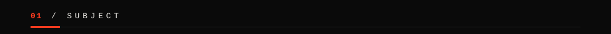
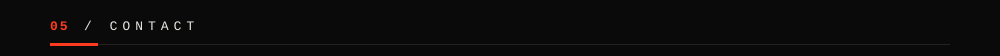

An AI/ML undergrad | Researching & exploring LLMs & Computer Vision | Building projects + communities in AI <a href="https://github.com/MyNeural">@MyNeural</a>

  

<a href="https://www.linkedin.com/in/krishna-srivastava-the-achiever/"><code>&nbsp;LINKEDIN&nbsp;</code></a>&nbsp;
<a href="https://x.com/KrishnaShr34553"><code>&nbsp;X&nbsp;</code></a>&nbsp;
<a href="https://instagram.com/krishna.sunspot"><code>&nbsp;INSTAGRAM&nbsp;</code></a>&nbsp;
<a href="mailto:krishna.2303604@icloud.com"><code>&nbsp;EMAIL&nbsp;</code></a>&nbsp;
<a href="https://drive.google.com/file/d/1OUheQggRh8MB9A3HZVNuEZq10iMaHADF/view?usp=sharing"><code>&nbsp;RESUME&nbsp;</code></a>&nbsp;
<a href="https://github.com/MyNeural"><code>&nbsp;@MyNeural&nbsp;</code></a>

