


  
  
  

<i>An AI/ML undergrad | Researching & Exploring LLMs & Computer Vision | Building projects + communities in AI <a href="https://github.com/MyNeural">@MyNeural</a></i>

  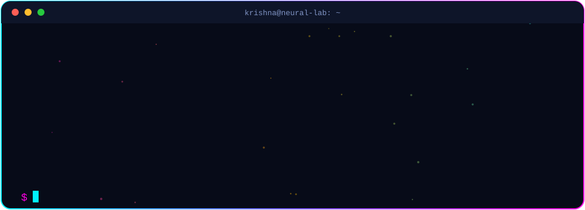


  

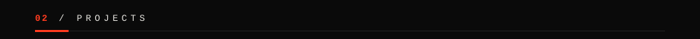

<a href="https://github.com/Krishna101010101010/Fidera-Privacy-First-AI-Document-Sharing-Intelligence-Platform.-">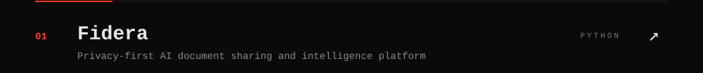</a>
<a href="https://github.com/Krishna101010101010/Samudrika-Underwater-Image-Enhancement-for-Maritime-Security"></a>
<a href="https://github.com/Krishna101010101010/RoadSense-RTDETR">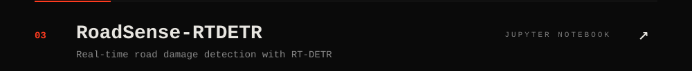</a>
<a href="https://github.com/Krishna101010101010/Grace"></a>


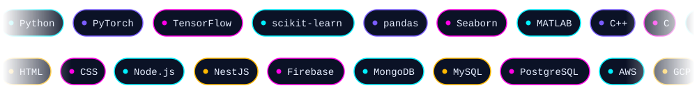

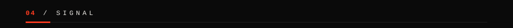

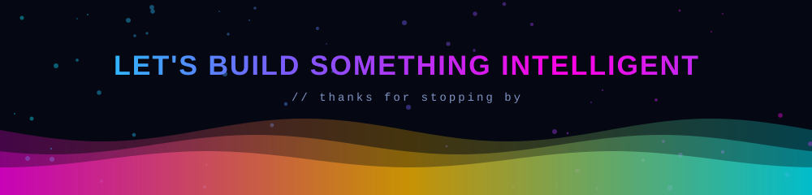

